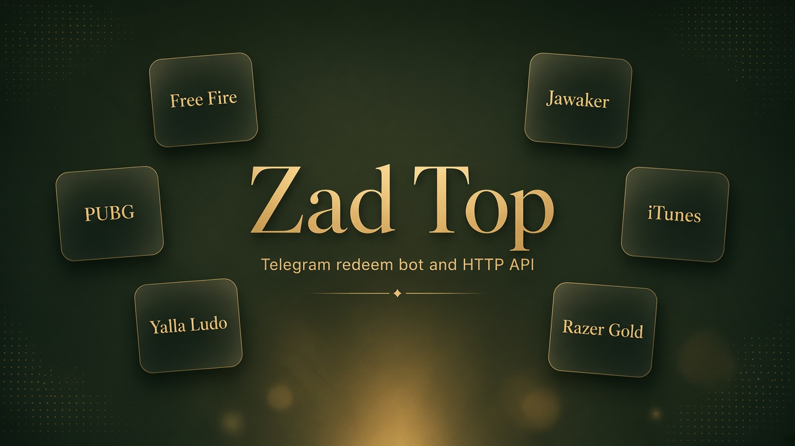
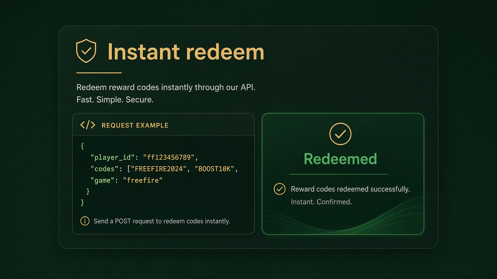
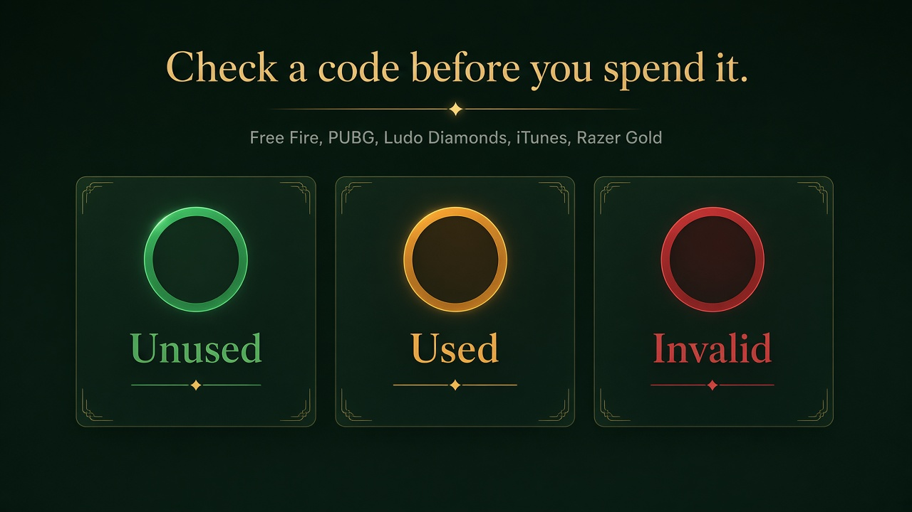

# واجهة زاد توب — فري فاير، ببجي، يلا لودو، جواكر، آيتونز، وريزر جولد

> بوت تلجرام وواجهة HTTP للمستقلين. اشحن الأكواد، افحصها قبل صرفها، اعرف اسم اللاعب، واحفظ مخزونك.  
> الخدمة مستقلة وليست تابعة لغارينا أو كرافتون أو تنسنت أو يلا جيمز أو آبل أو ريزر أو جواكر.

[البوت @ZadTopBot](https://t.me/ZadTopBot) · [الوثائق](https://api.zadtop.com/docs) · [Swagger](https://api.zadtop.com/swagger) · [الموقع](https://www.zadtop.com/) · [English](./README.md)

هذا المستودع **واجهة عامة للمطورين**. لا يحتوي على برنامج البوت.

## ماذا تفعل

- شحن فري فاير، شدات ببجي، ماس وذهب يلا لودو، وتوكنز جواكر على آيدي اللاعب
- فحص الكود دون شحنه: فري فاير، ببجي، ماس لودو، رصيد آيتونز، وأكواد ريزر جولد
- شحن كود ريزر جولد إلى محفظتك
- معرفة اسم اللاعب قبل أن يُستهلك أي كود
- حفظ المخزون داخل البوت والشحن باختيار الفئة

## الروابط

| | |
| --- | --- |
| الأساس | https://api.zadtop.com |
| المرجع | https://api.zadtop.com/docs |
| البوت | https://t.me/ZadTopBot |
| الدعم | https://t.me/ZadTop_support |
| صفحات غيت هب | https://aliothman123.github.io/zadtop-api/ |

المفتاح في الترويسة `X-API-Key`. من البوت: الاشتراك ثم HTTP API. يلزم باقة فعّالة وإضافة الواجهة (15 دولارًا / 30 يومًا). إنشاء مفتاح جديد يلغي السابق فورًا.

## الألعاب

| `game` | الشحن | الفحص |
| --- | --- | --- |
| `freefire` | نعم | غير مستخدم / مستخدم / غير صالح، مع الفئة |
| `pubg` | نعم | مع القيمة ووقت الاستخدام حين يعرفهما المتجر |
| `ludo` / `ludogold` | نعم مع `tier` | الماس فقط. الذهب بلا فحص، وإرسال كود ذهب إلى فحص الماس قد يستهلكه |
| `jawaker` | نعم | لا فحص مستقل. الرمز الطويل لا يُفحص |
| `itunes` | لا | الرصيد بالدولار. القراءة الأولى بعد هدوء قد تطول حتى دقيقة |
| `razer` | لا | صالح / مستخدم / خاطئ. لا يُستهلك الكود. **5 طلبات** لكل كود |
| `razer_recharge` | يشحن إلى محفظتك | البريد وكلمة السر. كلمة السر لا تُحفظ. **5 طلبات** لكل كود صدرت له نتيجة |

الشحن طلب واحد لكل كود. الفحص طلب واحد لكل كود، و**خمسة لريزر جولد**. كشف الاسم 0.25. رفض المتجر يُحسب، وما يفشل قبل صدور نتيجة يُعاد. الحساب الجديد يحصل على **10 عمليات شحن مجانية**.

الباقات من 25 إلى 10,000 عملية في اليوم لمدة 30 يومًا. السعر المعروض للعبة واحدة. لعبتان ×1.3، وكل الألعاب ×1.5. الدفع بـ USDT على TRC20 أو BEP20 أو TON أو Aptos.

كلمات البحث: بوت شحن فري فاير، فاحص أكواد فري فاير، شحن شدات ببجي، فحص كود ببجي، شحن يلا لودو، توكنز جواكر، فحص بطاقة آيتونز، فحص كود ريزر جولد، شحن ريزر جولد، ZadTopBot.
