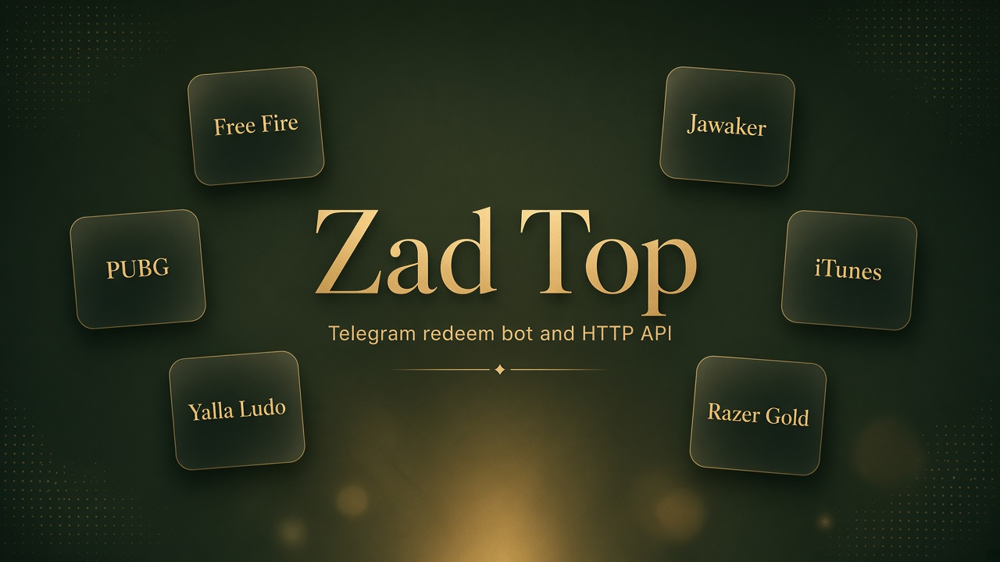
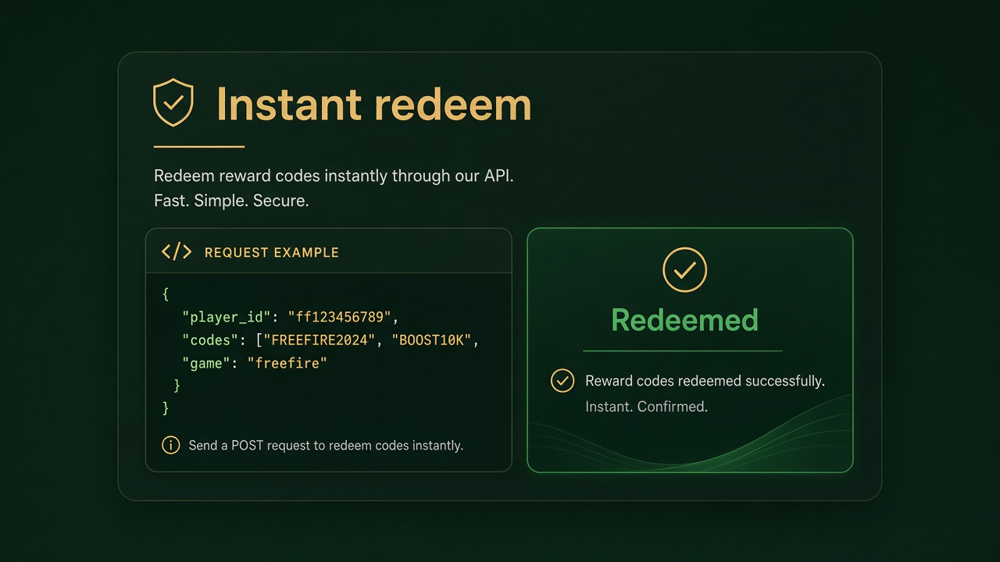
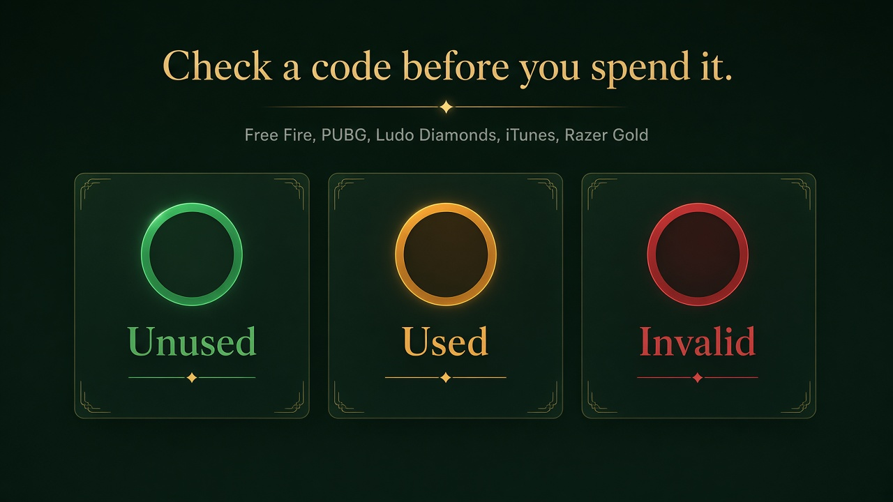
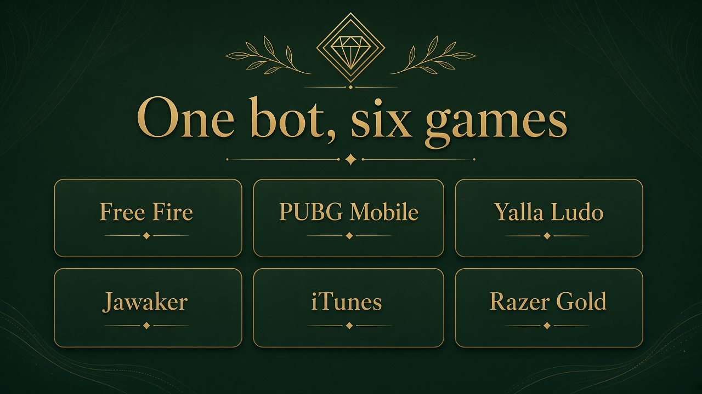

# Zad Top API — Free Fire, PUBG, Yalla Ludo, Jawaker, iTunes and Razer Gold

> Independent Telegram bot and HTTP API for resellers. Redeem codes, check them before you spend them, look up players, and keep your own stock.  
> Not affiliated with Garena, Krafton, Tencent, Yalla Games, Apple, Razer, or Jawaker.

[](https://t.me/ZadTopBot)
[](https://api.zadtop.com/docs)
[](https://api.zadtop.com/swagger)
[](https://www.zadtop.com/)

**Languages:** [English](./README.md) · [العربية](./README.ar.md) · [Türkçe](./README.tr.md) · [فارسی](./README.fa.md) · [اردو](./README.ur.md) · [हिन्दी](./README.hi.md) · [Русский](./README.ru.md) · [中文](./README.zh-CN.md)



This repository is the **public developer hub**. It does not contain the bot program. Live docs, the website, and the bot are linked above.

---

## What you can do

- **Redeem** Free Fire, PUBG Mobile UC, Yalla Ludo Diamonds and Gold, and Jawaker tokens to a player ID
- **Check** a card without redeeming it: Free Fire, PUBG, Yalla Ludo Diamonds, iTunes balances, and Razer Gold PINs
- **Recharge** a Razer Gold PIN into your own wallet
- **Look up** the in-game name before anything is spent
- **Keep stock** in the bot and redeem a pack instead of pasting codes
- **Download** the shop order image after a successful redeem

Built for reseller panels, shops, and your own bot.







---

## Links

| Resource | URL |
| --- | --- |
| API base | https://api.zadtop.com |
| HTML reference | https://api.zadtop.com/docs |
| Swagger | https://api.zadtop.com/swagger |
| OpenAPI | https://api.zadtop.com/openapi.json |
| Website | https://www.zadtop.com/ |
| Games | https://www.zadtop.com/games/ |
| Telegram bot | https://t.me/ZadTopBot |
| Support | https://t.me/ZadTop_support |
| GitHub Pages hub | https://aliothman123.github.io/zadtop-api/ |

Guides in this repo: [Quick start](./docs/QUICKSTART.md) · [Endpoints](./docs/ENDPOINTS.md) · [Games](./docs/GAMES.md) · [Responses](./docs/RESPONSES.md) · [FAQ](./docs/FAQ.md)

---

## Authentication

```http
X-API-Key: pk_YOUR_KEY
```

In [@ZadTopBot](https://t.me/ZadTopBot): Subscription → HTTP API. You need an active plan and the **HTTP API add-on** (15 USDT / 30 days). Creating a new key revokes the previous one. A **Code checking** subscription can call the check routes on its own.

---

## Main routes

| Method | Path | What it does |
| --- | --- | --- |
| `POST` | `/v1/jobs/instant-redeem` | Redeem codes for a player ID |
| `POST` | `/v1/jobs/stock-redeem` | Redeem from your stored stock |
| `POST` | `/v1/codes/check` | Read up to 20 cards without redeeming |
| `POST` | `/v1/jobs/code-check` | The same check, up to 10,000 cards, as a job |
| `GET` | `/v1/player/lookup` | In-game name and region |
| `GET` | `/v1/jobs/{id}` | Job state and result. Add `?wait=25` to wait |
| `GET` | `/v1/stock/summary` | Stock by game and pack |
| `POST` | `/v1/order/screenshot` | Shop order image |
| `GET` | `/v1/me` `/v1/quota` `/v1/history` `/v1/players` | Account, allowance, history, saved players |

A job that reaches `done` means the work finished. Each code has its own `success` and, on failure, `err_code`.

```bash
curl -sS -X POST https://api.zadtop.com/v1/jobs/instant-redeem \
  -H "X-API-Key: pk_YOUR_KEY" \
  -H "Content-Type: application/json" \
  -d '{"player_id":"2186053213","codes":["4233939008625064"],"game":"freefire"}'
```

---

## Games

| `game` | Redeem | Check |
| --- | --- | --- |
| `freefire` | yes | unused / used / invalid, plus the pack |
| `pubg` | yes | unused / used / expired / invalid, with value when the shop knows it |
| `ludo` / `ludogold` | yes, send `tier` | Diamonds only. Gold has no check — a Gold code sent to the Diamonds check can be spent |
| `jawaker` | yes | no standalone check. A 12-character pin cannot be checked |
| `itunes` | no | dollar balance. The first read after a quiet spell can take up to a minute |
| `razer` | no | live / used / invalid. The PIN is not spent. **5 requests** per PIN |
| `razer_recharge` | credits the PIN to your wallet | email + password. The password is not stored. **5 requests** per PIN that got a verdict |

---

## Plans (30 days, USDT)

The price below is for **one game**. Two games cost ×1.3. All games cost ×1.5. The daily limit resets at midnight UTC and is shared by the games on the plan, by the bot, and by the API.

| Plan | Daily redeems | One game |
| --- | --- | --- |
| P1 | 25 | 5 USDT |
| P2 | 200 | 10 USDT |
| P3 | 1,000 | 25 USDT |
| P4 | 2,500 | 50 USDT |
| P5 | 5,000 | 85 USDT |
| P6 | 10,000 | 135 USDT |
| HTTP API add-on | 30 days | 15 USDT |
| Code checking | 150,000 checks | 100 USDT |
| Code checking | 250,000 checks | 150 USDT |

A redeem costs 1 request per code. A check costs 1 per card, and **5 per Razer Gold PIN**. A player lookup costs 0.25. A shop refusal counts. A failure before a result is returned. New accounts get **10 free redeems**.

Pay in USDT on TRC20, BEP20, TON, or Aptos.

---

## Search terms

Free Fire redeem bot, Free Fire code checker, Garena voucher API, PUBG UC redeem API, PUBG UC code checker, Midasbuy-style UC API, Yalla Ludo diamonds redeem, Yalla Ludo gold redeem, Jawaker tokens API, iTunes gift card balance checker, Razer Gold PIN checker, Razer Gold recharge, Telegram reseller bot, ZadTopBot, zadtop.com.

---

## Disclaimer

Zad Top (zadtop.com, @ZadTopBot) is an independent service. Game names and marks belong to their owners. You are responsible for the codes you send and for the player ID you choose. A valid code is credited on the account you sent, from the first successful contact with the shop.
